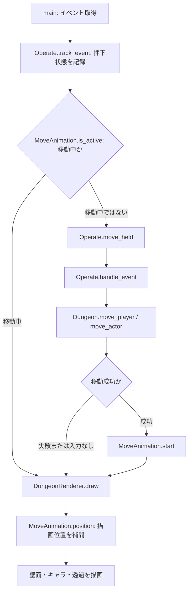

# クラス・メソッドの役割

現在の実装を読むための案内です。クラスやメソッドを追加・変更した際は、この一覧も更新します。
`_`で始まるメソッドは内部処理、`@property`はメソッド呼び出しではなく属性として読み出す値です。
データクラスが自動生成する初期化・比較などのメソッドは省略しています。

## 全体の分担

| ファイル | 担当 |
|---|---|
| `main.py` | 起動・各機能の接続・ゲームループ |
| `system/dungeon/dungeon.py` | 地形・配置・移動ルール・自動生成 |
| `system/operate.py` | キー設定・押下状態・移動指示 |
| `system/renderer.py` | 座標変換・描画・移動アニメーション・壁の透過 |
| `system/configuration.py` | YAMLの共通読み込み |
| `system/savedata/savedata.py` | 現在地など、プレイ中に変わる状態の保存 |
| `system/logs/tracing.py` | ログ出力・メソッド呼び出しの記録 |

座標の正本はDungeon内の2次元配列です。座標指定は`(x, y)`、配列参照は`[y][x]`です。
キャラクター自体には座標を持たせません。Rendererの小数座標は描画専用で、論理座標を書き換えません。

入力は`system/operate.py`、描画は`system/renderer.py`、マップ本体は`system/dungeon/`に置いています。
Rendererは自動生成処理を呼びません。同じDungeonデータを作れば、街・固定マップにも利用できます。
現在、街や固定マップのロード機能自体は未実装です。

## 1回の移動の流れ

移動ルールの変更はDungeon、入力の変更はOperate、見た目の変更はRendererで行います。
アイテム取得は論理座標の移動成功時に起こり、描画アニメーションの到着より先に確定します。

## main.py

| 関数 | 役割 | 戻り値 |
|---|---|---|
| `main(log_detail)` | 設定・ログ・Pygameを初期化。地形生成、初期配置、入力、移動開始、描画、FPS制御、終了を接続する | `None` |

`log_detail=None`ならYAMLの設定値を使用します。ダンジョン生成・初期配置が成功した後、`SaveData.enter_dungeon()`で現在地フラグを保存します。移動アニメーション中もキー解放・終了は処理し、次のマスへの移動は到着後に開始します。

## system/dungeon/dungeon.py

### データの型

| 型 | 役割・保持する値 |
|---|---|
| `Tile` | 地形の識別子。`FLOOR=0`、`WALL=1` |
| `Player` | プレイヤーの名前。座標は持たない |
| `Enemy` | 敵の名前。座標は持たない |
| `Item` | アイテムの名前。座標は持たない |
| `MoveResult` | 移動結果。`moved`（成否）、`reason`（理由）、`item`（取得物または`None`） |

### Dungeon：ゲーム状態と移動ルール

| メソッド・プロパティ | 役割 | 戻り値 |
|---|---|---|
| `__init__(width, height)` | 指定サイズの地形・配置配列を作る。初期地形は全て床 | `None` |
| `width` / `height` | マップの幅・高さを読む | 整数 |
| `terrain` | 床・壁の配列を読む。内部を直接変更できないようコピーを返す | 2次元配列 |
| `actors` | プレイヤー・敵の配置を読む。空きは`None`。配列はコピー | 2次元配列 |
| `items` | アイテム配置を読む。空きは`None`。配列はコピー | 2次元配列 |
| `in_bounds(x, y)` | 座標が範囲内か確認する | `bool` |
| `_check_bounds(x, y)` | 範囲外なら`ValueError`を送出する | `None` |
| `position_of(entity)` | 配列から指定オブジェクトの位置を探す。未配置ならエラー | `(x, y)` |
| `player_position` | プレイヤーの現在の論理座標を読む | `(x, y)`、未配置なら`None` |
| `set_tile(x, y, tile)` | 地形を変更する。配置物のあるマスを壁にはできない | `None` |
| `place(entity, x, y)` | 床に配置する。二重配置やプレイヤーの複数配置などを拒否する | `None` |
| `move_player(dx, dy)` | 配置済みプレイヤーの移動を`move_actor`へ委譲する | `MoveResult` |
| `move_actor(actor, dx, dy)` | 上下左右1マスの移動を検証し、移動元・先の配列を更新する | `MoveResult` |

移動失敗の理由は`out_of_bounds`、`wall`、`occupied`。成功時は`moved`です。
移動失敗時は配置を変更しません。プレイヤーだけが到達先のアイテムを取り除き、結果の`item`として受け取ります。
敵も移動APIは使えますが、現在のmainには敵の自動行動はありません。

### Room：生成した部屋の形

`x`、`y`は左上、`width`、`height`は床領域の幅・高さです。

| メソッド・プロパティ | 役割 | 戻り値 |
|---|---|---|
| `center` | 部屋中央のマス座標を計算する | `(x, y)` |
| `overlaps(other, gap)` | 別の部屋と重なる、または指定間隔を確保できないか調べる | `bool` |

### DungeonGenerator：地形生成と初期配置

| メソッド | 役割 | 戻り値 |
|---|---|---|
| `__init__(...)` | マップ寸法、部屋数・サイズ、壁厚、通路幅、試行上限、seedを受け取り検証する | `None` |
| `generate()` | 指定個数の部屋を選び、全面壁のマップへ部屋と通路を掘る。全室を接続し、部屋情報を`rooms`へ保存 | `Dungeon` |
| `_carve(dungeon, start, end)` | 横または縦の中心線を通路幅に広げて床を掘る | `None` |
| `populate(dungeon, player_name, item_names, enemy_names)` | 最初の部屋の中心にプレイヤーを配置し、残りの床へ敵・アイテムを重複しないよう配置する | `None` |

`populate`の前に`generate`が必要です。部屋はランダム配置し、追加する各部屋を既存の最も近い部屋へL字通路で結びます。
`max_attempts`内で指定個数を配置できなければエラーです。seedを固定すると地形・初期配置を再現できます。

## system/operate.py

### OperateSettings：操作設定

`move_up`、`move_down`、`move_left`、`move_right`、`quit`にPygameのキーコードを保持します。

| メソッド | 役割 | 戻り値 |
|---|---|---|
| `load()` | `values/operate.yml`を読み、`from_dict`へ渡す | `OperateSettings` |
| `from_dict(data)` | キー名をキーコードへ変換し、不足・不正な名前・重複割り当てを拒否する | `OperateSettings` |

### Operate：キー入力から移動指示へ

| メソッド | 役割 | 戻り値 |
|---|---|---|
| `__init__(dungeon, settings)` | 対象マップ、操作設定、方向ベクトル、押下中のキー一覧を準備する | `None` |
| `track_event(event)` | 押下・解放を記録する。フォーカスを失ったら押下状態を解除 | `None` |
| `move_held()` | 押下中のキーのうち最後に押した方向を`handle_event`へ渡す | `MoveResult`、入力なしなら`None` |
| `is_quit_event(event)` | ウィンドウを閉じる操作、または設定された終了キーか確認する | `bool` |
| `handle_event(event)` | 移動キーのKEYDOWNを方向へ変換して`Dungeon.move_player`を呼ぶ。座標・取得物のログも出す | `MoveResult`、対象外なら`None` |

## system/renderer.py

### MoveAnimation：描画専用の移動補間

| メソッド | 役割 | 戻り値 |
|---|---|---|
| `__init__(duration_ms)` | 1マスの移動時間を検証して保持する | `None` |
| `start(start, end, now_ms)` | 移動元・移動先・開始時刻を記録する | `None` |
| `is_active(now_ms)` | 指定時刻が移動アニメーションの途中か調べる | `bool` |
| `position(now_ms)` | 時間から小数の描画位置を線形補間する。完了後は移動先を返す | 座標、未開始なら`None` |

### DungeonRenderer：表示と壁の見せ方

| メソッド | 役割 | 戻り値 |
|---|---|---|
| `__init__(screen, operate_settings)` | 描画先・設定・フォント・移動補間・透過用サーフェスを準備する | `None` |
| `_make_fade_circle()` | 中心が半透明、外側が不透明になる円形グラデーションを作る。生成後は再利用する | `pygame.Surface` |
| `_prepare_fade_mask(dungeon)` | 補間済みプレイヤー位置に円形マスクを配置する | `None` |
| `map_to_screen(x, y, dungeon)` | 整数または小数のマップ座標を、カメラを考慮した画面座標へ変換する | ピクセル座標 |
| `_diamond(cx, cy)` | 床タイルのひし形の4頂点を計算する | 頂点のリスト |
| `wall_faces(terrain, x, y)` | 床の隣が壁または範囲外になっている境界を列挙する。床同士・壁内部には面を作らない | `(方向名, dx, dy)`のリスト |
| `_draw_wall_face(cx, cy, direction, dx, dy)` | 境界に薄い2段の壁面と細い天端を描く。南・東の手前面だけ円形透過を適用 | `None` |
| `_draw_actor(actor, cx, cy)` | プレイヤー・敵の仮の図形、影、識別文字を描く | `None` |
| `draw(dungeon, now_ms)` | カメラとマスクを更新。表示範囲の床・壁の下地を描き、壁面・アイテム・キャラを奥行き順に描画し、操作案内を表示 | `None` |

壁の当たり判定は2次元配列のままです。見た目の厚みは独立しており、現在は床の境界だけに薄い壁面を立てます。
全壁面は2段で、端の低下・斜面・0.5マスへの変更は行いません。
壁マスの下地には床のマス目を描かず、円形透過は壁面の画素に適用します。
北・西の壁面は不透明、南・東の壁面は円の範囲で透過します。

## system/configuration.py

| 関数 | 役割 | 戻り値 |
|---|---|---|
| `load_settings(filename)` | プロジェクトの`values/`からYAMLを安全に読み込む。最上位が辞書でなければエラー | `dict` |

実行ディレクトリには依存しません。設定不足をコード内の既定値で補う機能はありません。

## system/savedata/savedata.py

### SaveData：現在地などの保存

保存先は`values/savedata.yml`。現在の内容は`dungeon: true`だけです。街への移動・階層の保存・現在地による操作切り替えは未実装です。

| メソッド | 役割 | 戻り値 |
|---|---|---|
| `__init__(path)` | 保存先を指定する。省略時はプロジェクトの`values/savedata.yml` | `None` |
| `load()` | 保存したマッピングを読む。未作成なら空の辞書。不正な形式ならエラー | `dict` |
| `enter_dungeon()` | 既存のキーを残しつつ`dungeon`を`true`にして保存する | `None` |
| `_save(data)` | 同じフォルダの一時ファイルにYAMLを書き、保存先を置換する | `None` |

## system/logs/tracing.py

### DetailLogger：重大度と詳細度の制御

| メソッド | 役割 | 戻り値 |
|---|---|---|
| `enabled(detail)` | 指定の詳細度を現在の設定で出すか調べる | `bool` |
| `emit_detail(severity, detail, message, ...)` | 詳細度を確認し、`INFO1`などのラベルを付けて記録する | `None` |
| `info1()` / `info2()` / `info3()` | 通常情報を各詳細度で出す | `None` |
| `warn1()` / `warn2()` / `warn3()` | 警告を各詳細度で出す | `None` |
| `error1()` / `error2()` / `error3()` | エラーを各詳細度で出す | `None` |

### ログの共通関数

| 関数 | 役割 | 戻り値 |
|---|---|---|
| `configure_logging(detail)` | 詳細度と出力形式を設定。ターミナルと`system/logs/game.log`へ出す。ファイルは起動ごとに上書き | `None` |
| `reset_trace_calls()` | 呼び出しログの重複抑制状態をリセットする | `None` |
| `begin_trace_frame()` | フレーム開始を記録。前フレームと今フレームの呼び出しを比較できる状態にする | `None` |
| `trace_method(method, detail)` | 呼び出し開始・引数・戻り値・例外を記録するラッパーを作る。元の戻り値・例外は呼び出し元へ伝える | ラッパー関数 |
| `trace_class(info_methods=...)` | クラスのメソッドとproperty参照へ`trace_method`を適用するデコレーターを作る | デコレーター関数 |

`trace_method`内の`wrapped`は実際の呼び出しを包み、`trace_class`内の`decorate`は対象クラスへラッパーを設定します。
`info_methods`に指定した主要メソッドはINFO1で名前、INFO2で引数・戻り値を記録。それ以外とproperty参照はINFO3です。
同一インスタンス・同一メソッドの同フレーム内および連続フレームの繰り返しは初回だけ記録します。例外は毎回記録します。

## 設定と変更箇所の対応

| 変更したいこと | 設定・実装 |
|---|---|
| キー割り当て | `values/operate.yml` → `OperateSettings` |
| 現在ダンジョンにいるか | `values/savedata.yml`の`dungeon` → `SaveData` |
| 画面サイズ・FPS・ログ初期値 | `values/setting.yml` → `main()` |
| マップ寸法・部屋数・サイズ・通路幅・壁厚・seed | `values/setting.yml` → `DungeonGenerator` |
| 初期のプレイヤー名・敵名・アイテム名 | `values/setting.yml` → `DungeonGenerator.populate()` |
| マス移動・衝突・取得ルール | `Dungeon.move_actor()` |
| 長押し・キー解放・同時押し | `Operate.track_event()` / `move_held()` |
| 移動アニメーションの速度 | `values/renderer.yml`の`move_animation` → `MoveAnimation` |
| 床・キャラの色やサイズ | `values/renderer.yml` → `DungeonRenderer` |
| 壁の段別の高さ・色 | `values/renderer.yml`の`wall_layers` |
| 壁の見た目の薄さ | `values/renderer.yml`の`wall_cap_width_tiles` |
| 円形透過の半径・柔らかさ・透明度 | `values/renderer.yml`の`wall_occlusion` |

テストの分類と実行コマンドは[tests/README.md](../tests/README.md)、開発ルールは[AGENTS.md](../AGENTS.md)を参照してください。
