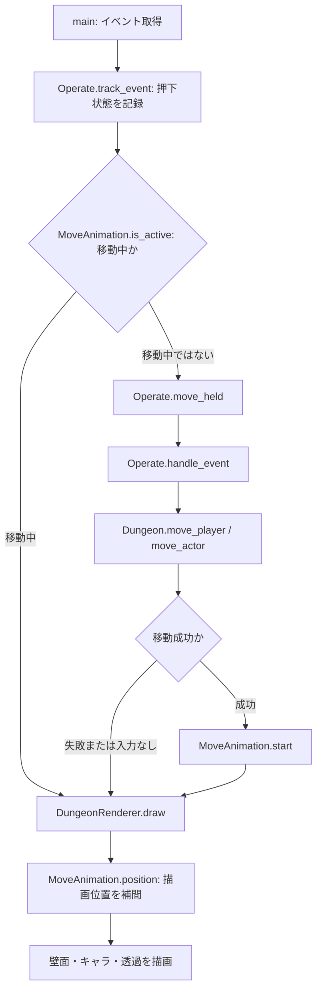

# クラス・メソッドの役割

現在の実装を読むための案内です。クラスやメソッドを追加・変更した際は、この一覧も更新します。
`_`で始まるメソッドは内部処理、`@property`はメソッド呼び出しではなく属性として読み出す値です。
データクラスが自動生成する初期化・比較などのメソッドは省略しています。

## 全体の分担

| ファイル | 担当 |
|---|---|
| `main.py` | 起動・各機能の接続・ゲームループ |
| `system/dungeon/dungeon.py` | 地形・配置・移動ルール・自動生成 |
| `system/operate.py` | キー設定・押下状態・移動指示 |
| `system/renderer.py` | 座標変換・描画・移動アニメーション・壁の透過 |
| `system/configuration.py` | YAMLの共通読み込み |
| `system/savedata/savedata.py` | 現在地など、プレイ中に変わる状態の保存 |
| `system/logs/tracing.py` | ログ出力・メソッド呼び出しの記録 |

座標の正本はDungeon内の2次元配列です。座標指定は`(x, y)`、配列参照は`[y][x]`です。
キャラクター自体には座標を持たせません。Rendererの小数座標は描画専用で、論理座標を書き換えません。
高さは`elevations[y][x]`の整数値（1=0.5マスの精度、2=1マス、4=2マス）で管理します。
階段は床の半段とは別の`StairBlock`で、1ブロックが標高を1マスつなぎます。階段マスの高さ配列は中央の標高を保持します。
ダンジョンの階層番号（将来の0〜99F）とは別の値です。現在の高台の下には入れません。

入力は`system/operate.py`、描画は`system/renderer.py`、マップ本体は`system/dungeon/`に置いています。
Rendererは自動生成処理を呼びません。同じDungeonデータを作れば、街・固定マップにも利用できます。
現在、街や固定マップのロード機能自体は未実装です。

## 1回の移動の流れ

移動ルールの変更はDungeon、入力の変更はOperate、見た目の変更はRendererで行います。
アイテム取得は論理座標の移動成功時に起こり、描画アニメーションの到着より先に確定します。

## main.py

| 関数 | 役割 | 戻り値 |
|---|---|---|
| `main(log_detail)` | 設定・ログ・Pygameを初期化。地形生成、初期配置、入力、移動開始、描画、FPS制御、終了を接続する | `None` |

`log_detail=None`ならYAMLの設定値を使用します。ダンジョン生成・初期配置が成功した後、`SaveData.enter_dungeon()`で現在地フラグを保存します。移動アニメーション中もキー解放・終了は処理し、次のマスへの移動は到着後に開始します。

## system/dungeon/dungeon.py

### データの型

| 型 | 役割・保持する値 |
|---|---|
| `Tile` | 地形の識別子。`FLOOR=0`、`WALL=1` |
| `Player` | プレイヤーの名前。座標は持たない |
| `Enemy` | 敵の名前。座標は持たない |
| `Item` | アイテムの名前。座標は持たない |
| `MoveResult` | 移動結果。`moved`（成否）、`reason`（理由）、`item`（取得物または`None`） |
| `StairBlock` | 専用の階段ブロック。下端標高`base_height`と上り方向`up_direction`を持ち、上端は下端＋1マス |

### Dungeon：ゲーム状態と移動ルール

| メソッド・プロパティ | 役割 | 戻り値 |
|---|---|---|
| `__init__(width, height)` | 指定サイズの地形・配置配列を作る。初期地形は全て床 | `None` |
| `width` / `height` | マップの幅・高さを読む | 整数 |
| `terrain` | 床・壁の配列を読む。内部を直接変更できないようコピーを返す | 2次元配列 |
| `actors` | プレイヤー・敵の配置を読む。空きは`None`。配列はコピー | 2次元配列 |
| `items` | アイテム配置を読む。空きは`None`。配列はコピー | 2次元配列 |
| `elevations` | 各床・階段中央の高さを0.5マス単位の整数で読む。配列はコピー | 2次元配列 |
| `stair_axes` | 階段ブロックから軸を導出する。`x`・`y`・階段でない場所は`None` | 2次元配列 |
| `stair_blocks` | 各マスの専用階段ブロックを読む。空きは`None`、配列はコピー | 2次元配列 |
| `floor_height(x, y)` | 指定マスの高さを通常のマス単位へ変換する | `float` |
| `set_elevation(x, y, half_steps)` | 配置物のない床に高さを設定する。階段情報は解除する | `None` |
| `set_stair_block(x, y, base_height, up_direction)` | 床に専用階段を設定し、中央の標高も記録する | `None` |
| `edge_height(x, y, dx, dy)` | 指定方向の出入口標高を調べる。階段の横面には出入口がない | `float`または`None` |
| `surface_height(x, y)` | 小数の描画位置から標高を計算する。階段の中は下端から上端へ連続変化 | `float` |
| `can_step(x, y, nx, ny)` | 地形・段差・階段の向きから1マス移動可能か調べる。キャラクター占有は考慮しない | `bool` |
| `reachable_from(start)` | 階段・標高差を含む実移動ルールで到達できる全マスを探索する。配置物は考慮しない | 座標の集合 |
| `in_bounds(x, y)` | 座標が範囲内か確認する | `bool` |
| `_check_bounds(x, y)` | 範囲外なら`ValueError`を送出する | `None` |
| `position_of(entity)` | 配列から指定オブジェクトの位置を探す。未配置ならエラー | `(x, y)` |
| `player_position` | プレイヤーの現在の論理座標を読む | `(x, y)`、未配置なら`None` |
| `set_tile(x, y, tile)` | 地形を変更する。配置物のあるマスを壁にはできない | `None` |
| `place(entity, x, y)` | 床に配置する。二重配置やプレイヤーの複数配置などを拒否する | `None` |
| `move_player(dx, dy)` | 配置済みプレイヤーの移動を`move_actor`へ委譲する | `MoveResult` |
| `move_actor(actor, dx, dy)` | 上下左右1マスの移動を検証し、移動元・先の配列を更新する | `MoveResult` |

移動失敗の理由は`out_of_bounds`、`wall`、`occupied`、段差による`height_blocked`。成功時は`moved`です。
隣接マス間の出入口の標高が一致すれば移動できます。階段マスは下端・上端だけに出入口があり、横入りや崖の上り下りはできません。
移動失敗時は配置を変更しません。プレイヤーだけが到達先のアイテムを取り除き、結果の`item`として受け取ります。
敵も移動APIは使えますが、現在のmainには敵の自動行動はありません。

### Room：生成した床区画

`x`、`y`は左上、`width`、`height`は床領域の幅・高さ、`elevation`は生成時に決めた区画の標高（現在の候補は1〜4）です。
区画全体を指定標高に揃え、異なる標高への接続部分では低い側の床を階段・上端の1マス踊り場へ置き換える場合があります。高低差が3なら階段ブロックを3個連ねます。

| メソッド・プロパティ | 役割 | 戻り値 |
|---|---|---|
| `center` | 部屋中央のマス座標を計算する | `(x, y)` |
| `overlaps(other, gap)` | 別の部屋と重なる、または指定間隔を確保できないか調べる | `bool` |
| `adjoins(other, min_overlap)` | 指定幅以上の共通辺で、別の床区画に隣接しているか調べる | `bool` |

### EntrancePlan：部屋と同時に確定する接続計画

`room`は高さを持つ部屋、`run`は入口から通常通路への中心線、`protected`は階段・踊り場と壁際の予約範囲、`area`は通路幅を含む進入部分、`stair_area`は階段を置いてよい座標です。全て部屋の採用前に決めます。後から置く部屋も、既存の計画と衝突できません。`DungeonGenerator.entrance_plans`には採用した全区画の計画が部屋と同じ順番で入ります。

### DungeonGenerator：地形生成と初期配置

| メソッド | 役割 | 戻り値 |
|---|---|---|
| `__init__(...)` | マップ寸法、床区画の個数・定型サイズ・標高候補、隣接確率、通路標高、壁厚、通路幅、階段・段差の許可側、踊り場の長さ、試行上限、seedを検証する | `None` |
| `_candidate_room(rooms)` | 定型サイズと標高を選び、ランダム配置または既存区画に接する配置の候補を作る | `Room` |
| `generate()` | RNGを初期化し、計画・経路が成立するまで`layout_attempts`を上限に再生成する。配置後の間隔補正は行わない | `Dungeon` |
| `_generate_layout()` | 部屋と高さに応じた入口計画をセットで採用し、計画済みの入口へ通路を引いて標高・階段を反映する | `Dungeon` |
| `_room_cliff_allowed(first, second)` | 異標高の区画が接するとき、高い床の許可側の段差かを両区画の位置から調べる | `bool` |
| `_hidden_cliff_buffer(room)` | 通路が接すると禁止側の段差になる区画外側の1列を返す。通路より部屋が低い場合は方向を反転する | 座標の`frozenset` |
| `_plan_entrance(room, rooms, plans)` | 部屋の高さから階段・踊り場・入口までの長さを決め、他の部屋と既存計画に衝突しない候補を選ぶ。空間不足なら部屋を採用しない | `EntrancePlan`または`None` |
| `_route_corridors(dungeon, rooms)` | 部屋と同時に確定した`entrance_plans`を受け取り、別通路の幅を含めて予約領域と横の壁際を避けて入口同士を結ぶ | `None` |
| `_height_regions(dungeon)` | 同じ標高でつながる床を連結領域へ分ける | 領域番号の2次元配列と領域数 |
| `_room_stair_layouts(x, y, direction, room, terrain, elevations, start)` | 段差に平行な階段を左右両方向で検討する。上端に高い床と同標高の1マス踊り場、下端に低い床を確保する | 階段・踊り場の配置候補一覧 |
| `_stair_layout(chain, terrain, elevations, start)` | 通路の階段候補を横幅全体に拡張する。自動生成では予約範囲内だけを許可し、階段・踊り場の横から通路が合流する候補は却下する | 階段配置、設置不可なら`None` |
| `_connect_elevations(dungeon)` | 低い側に標高差と同数の階段ブロックと踊り場を確保する。通路は幅全体、部屋は段差に平行な階段と1マス踊り場で接続する。配置を変えて再試行し、全床への到達を検証する | `None` |
| `_carve(dungeon, start, end)` | 横または縦の中心線を通路幅に広げて床を掘る | `None` |
| `populate(dungeon, player_name, item_names, enemy_names)` | 最初の部屋の中心にプレイヤーを配置し、階段を除く残りの床へ敵・アイテムを重複しないよう配置する | `None` |

`populate`の前に`generate`が必要です。隣接区画は共通辺で接続し、離れた区画は許可された側の入口へ通路を引きます。通路の中心線は区画を通路半幅だけ拡張した領域を避け、BFSで既存通路へ接続します。これにより、部屋を横断した通路が禁止側だけで行き止まりになる問題を防ぎます。
区画の標高は`section_elevations`、通路は`corridor_elevation`で指定します。同標高なら直接歩け、異標高の接続には許可側だけ階段を置きます。
`max_attempts`内で指定個数を配置できない場合も、別の区画配置で再試行します。`stair_attempts`内で全床への到達を確保できない場合は`StairPlacementError`となり、`generate`が別の区画配置で再試行します。`layout_attempts`を使い切った場合もエラーです。
`StairPlacementError`は区画配置・階段用の空間不足・接続不成立を表す`ValueError`の派生クラスです。
seedを固定すると区画・標高・階段・初期配置を再現できます。

## system/operate.py

### OperateSettings：操作設定

`move_up`、`move_down`、`move_left`、`move_right`、`quit`にPygameのキーコードを保持します。

| メソッド | 役割 | 戻り値 |
|---|---|---|
| `load()` | `values/operate.yml`を読み、`from_dict`へ渡す | `OperateSettings` |
| `from_dict(data)` | キー名をキーコードへ変換し、不足・不正な名前・重複割り当てを拒否する | `OperateSettings` |

### Operate：キー入力から移動指示へ

| メソッド | 役割 | 戻り値 |
|---|---|---|
| `__init__(dungeon, settings)` | 対象マップ、操作設定、方向ベクトル、押下中のキー一覧を準備する | `None` |
| `track_event(event)` | 押下・解放を記録する。フォーカスを失ったら押下状態を解除 | `None` |
| `move_held()` | 押下中のキーのうち最後に押した方向を`handle_event`へ渡す | `MoveResult`、入力なしなら`None` |
| `is_quit_event(event)` | ウィンドウを閉じる操作、または設定された終了キーか確認する | `bool` |
| `handle_event(event)` | 移動キーのKEYDOWNを方向へ変換して`Dungeon.move_player`を呼ぶ。座標・取得物のログも出す | `MoveResult`、対象外なら`None` |

## system/renderer.py

### MoveAnimation：描画専用の移動補間

| メソッド | 役割 | 戻り値 |
|---|---|---|
| `__init__(duration_ms)` | 1マスの移動時間を検証して保持する | `None` |
| `start(start, end, now_ms, start_height, end_height)` | 移動元・移動先・開始時刻・移動前後の高さを記録する | `None` |
| `is_active(now_ms)` | 指定時刻が移動アニメーションの途中か調べる | `bool` |
| `position(now_ms)` | 時間から小数の描画位置を線形補間する。完了後は移動先を返す | 座標、未開始なら`None` |
| `height(now_ms)` | 時間から描画用の高さを線形補間する | `float`、未開始なら`None` |

### DungeonRenderer：表示と壁の見せ方

| メソッド | 役割 | 戻り値 |
|---|---|---|
| `__init__(screen, operate_settings)` | 描画先・設定・フォント・移動補間・透過用サーフェスを準備する | `None` |
| `_make_fade_circle()` | 中心が半透明、外側が不透明になる円形グラデーションを作る。生成後は再利用する | `pygame.Surface` |
| `_prepare_fade_mask(dungeon)` | 補間済みプレイヤー位置に円形マスクを配置する | `None` |
| `map_to_screen(x, y, dungeon, elevation)` | 整数または小数のマップ座標を、高さとカメラを考慮した画面座標へ変換する | ピクセル座標 |
| `_diamond(cx, cy)` | 床タイルのひし形の4頂点を計算する | 頂点のリスト |
| `wall_faces(terrain, x, y)` | 床の隣が壁または範囲外になっている境界を列挙する。床同士・壁内部には面を作らない | `(方向名, dx, dy)`のリスト |
| `_wall_profiles(terrain, elevations, stairs)` | 各壁面の両端の床標高を求める。階段は方向と下端・上端から傾斜を計算し、地形が同じ間は結果を再利用する | 壁面座標・方向ごとの両端標高 |
| `_wall_join_posts(profiles)` | 別の床マスの2壁面が同じ標高で直角に接する角を特定する。`_wall_ends`と共有の頂点照合で計算・キャッシュ | `(x, y, 標高, 奥行き, 透過対象, 左端判定)`のタプル列 |
| `_draw_wall_join_post(cx, cy, elevation, fade, left_corner=False)` | 別マス間の角へ設定幅の細い柱を重ねる。各段・支持部は壁色、上端は天面色とし、壁と同じ透過を使う | `None` |
| `_paint_wall_post(target, cx, cy, elevation, side)` | 柱本体の各段・支持部と、壁より高い丸い柱頭を共通描画する。壁の段境界を保ち、追加の高さは上段へ加える | `None` |
| `_draw_post_cap(target, cx, cy, side)` | 円形の柱頭を斜めから見た楕円と厚みを描く。同じ床の角・別マス間の角で共用 | `None` |
| `_draw_wall_face(cx, cy, direction, dx, dy, endpoint_heights=(0, 0), exposed_ends=(), support_depths=(0, 0), cap_ends=())` | 境界の両端標高から薄い2段の壁面と細い天端を描く。階段沿いは上端・段の境目も斜めになる。接続する角の天端は縦の輪郭に揃える。南・東の手前面だけ円形透過を適用 | `None` |
| `_draw_actor(actor, cx, cy)` | プレイヤー・敵の仮の図形、影、識別文字を描く | `None` |
| `_draw_floor(cx, cy, raised, parity, elevation=0, cliff_edges=())` | 地上・段床の上面を色分けして描く | `None` |
| `_draw_stair_block(x, y, block, dungeon)` | 1マス高の専用階段を複数の踏み段と側面で描く。段数はYAMLで指定 | `None` |
| `_draw_riser(cx, cy, direction, drop_pixels)` | 高い床から低い床へ落ちる南・東の側面を描く | `None` |
| `draw(dungeon, now_ms)` | カメラとマスクを更新。表示範囲の床・壁の下地を描き、壁面・アイテム・キャラを奥行き順に描画し、操作案内を表示 | `None` |

壁の当たり判定は2次元配列のままです。見た目の厚みは独立しており、現在は床の境界だけに薄い壁面を立てます。
全壁面は床から2段です。階段沿いではその2段を維持して傾斜させ、上下の床の標高を直線で結びます。最高標高への底上げは行いません。
壁マスの下地には床のマス目を描かず、円形透過は壁面の画素に適用します。
北・西の壁面は不透明、南・東の壁面は円の範囲で透過します。
段床の床・アイテム・キャラは高さぶん画面上へ移します。プレイヤーとカメラの標高は、補間したマップ位置から`surface_height`で求めます。階段へ入る前は地上、階段内は傾斜に沿い、上端では段床へつながります。
`MoveAnimation.height()`も一般的な高さ補間用に残していますが、現在のプレイヤー描画は地形の傾斜を優先します。
壁の2段は維持し、床の側面（高台の土台）とダンジョンの壁は別の描画として扱います。

## system/configuration.py

| 関数 | 役割 | 戻り値 |
|---|---|---|
| `load_settings(filename)` | プロジェクトの`values/`からYAMLを安全に読み込む。最上位が辞書でなければエラー | `dict` |

実行ディレクトリには依存しません。設定不足をコード内の既定値で補う機能はありません。

## system/savedata/savedata.py

### SaveData：現在地などの保存

保存先は`values/savedata.yml`。現在の内容は`dungeon: true`だけです。街への移動・階層の保存・現在地による操作切り替えは未実装です。

| メソッド | 役割 | 戻り値 |
|---|---|---|
| `__init__(path)` | 保存先を指定する。省略時はプロジェクトの`values/savedata.yml` | `None` |
| `load()` | 保存したマッピングを読む。未作成なら空の辞書。不正な形式ならエラー | `dict` |
| `enter_dungeon()` | 既存のキーを残しつつ`dungeon`を`true`にして保存する | `None` |
| `_save(data)` | 同じフォルダの一時ファイルにYAMLを書き、保存先を置換する | `None` |

## system/logs/tracing.py

### DetailLogger：重大度と詳細度の制御

| メソッド | 役割 | 戻り値 |
|---|---|---|
| `enabled(detail)` | 指定の詳細度を現在の設定で出すか調べる | `bool` |
| `emit_detail(severity, detail, message, ...)` | 詳細度を確認し、`INFO1`などのラベルを付けて記録する | `None` |
| `info1()` / `info2()` / `info3()` | 通常情報を各詳細度で出す | `None` |
| `warn1()` / `warn2()` / `warn3()` | 警告を各詳細度で出す | `None` |
| `error1()` / `error2()` / `error3()` | エラーを各詳細度で出す | `None` |

### ログの共通関数

| 関数 | 役割 | 戻り値 |
|---|---|---|
| `configure_logging(detail)` | 詳細度と出力形式を設定。ターミナルと`system/logs/game.log`へ出す。ファイルは起動ごとに上書き | `None` |
| `reset_trace_calls()` | 呼び出しログの重複抑制状態をリセットする | `None` |
| `begin_trace_frame()` | フレーム開始を記録。前フレームと今フレームの呼び出しを比較できる状態にする | `None` |
| `trace_method(method, detail)` | 呼び出し開始・引数・戻り値・例外を記録するラッパーを作る。元の戻り値・例外は呼び出し元へ伝える | ラッパー関数 |
| `trace_class(info_methods=...)` | クラスのメソッドとproperty参照へ`trace_method`を適用するデコレーターを作る | デコレーター関数 |

`trace_method`内の`wrapped`は実際の呼び出しを包み、`trace_class`内の`decorate`は対象クラスへラッパーを設定します。
`info_methods`に指定した主要メソッドはINFO1で名前、INFO2で引数・戻り値を記録。それ以外とproperty参照はINFO3です。
同一インスタンス・同一メソッドの同フレーム内および連続フレームの繰り返しは初回だけ記録します。例外は毎回記録します。

## 設定と変更箇所の対応

| 変更したいこと | 設定・実装 |
|---|---|
| キー割り当て | `values/operate.yml` → `OperateSettings` |
| 現在ダンジョンにいるか | `values/savedata.yml`の`dungeon` → `SaveData` |
| 画面サイズ・FPS・ログ初期値 | `values/setting.yml` → `main()` |
| マップ寸法・区画数・定型サイズ・通路幅・壁厚・seed | `values/setting.yml` → `DungeonGenerator` |
| 区画の標高・隣接確率・通路標高 | `values/setting.yml`の`section_elevations`・`adjacent_probability`・`corridor_elevation` |
| 高さ・階段・崖の移動制限 | `Dungeon.set_elevation()` / `set_stair_block()` / `can_step()` |
| 階段ブロック内の描画上の踏み段数 | `values/renderer.yml`の`stairs.treads_per_block` |
| 初期のプレイヤー名・敵名・アイテム名 | `values/setting.yml` → `DungeonGenerator.populate()` |
| マス移動・衝突・取得ルール | `Dungeon.move_actor()` |
| 長押し・キー解放・同時押し | `Operate.track_event()` / `move_held()` |
| 移動アニメーションの速度 | `values/renderer.yml`の`move_animation` → `MoveAnimation` |
| 床・キャラの色やサイズ | `values/renderer.yml` → `DungeonRenderer` |
| 壁の段別の高さ・色 | `values/renderer.yml`の`wall_layers` |
| 壁の見た目の薄さ | `values/renderer.yml`の`wall_cap_width_tiles` |
| 円形透過の半径・柔らかさ・透明度 | `values/renderer.yml`の`wall_occlusion` |

テストの分類と実行コマンドは[tests/README.md](../tests/README.md)、開発ルールは[AGENTS.md](../AGENTS.md)を参照してください。

階段の踏み面・縁・側面は、床と共通の`platform_even` / `platform_odd`・`grid`・`platform_side_left` / `platform_side_right`を使います。`stairs.treads_per_block`は現在2です。高い地形の画面外判定にも標高を加味します。

部屋の階段は段差に対して横向きです。階段を上った先の1マス踊り場で90度曲がり、高い床へ入ります。生成候補では方向が`None`の要素を平らな踊り場として扱い、`set_elevation`で更新します。階段の横入り許可など、移動ルールの例外は設けません。

### 主人公が地形に隠れた場合

`DungeonRenderer._player_visibility_snapshot(cx, cy)`は主人公描画直後の画素と頭・体の形を保存します（影は除外）。`_draw_occluded_player(snapshot)`は地形描画完了後に画素を比較し、後から覆われた部分だけに主人公色のシルエットを重ねます。見えている部分は変更しません。設定は`values/renderer.yml`の`player_occlusion.enabled`と`alpha`です。壁・床の当たり判定や透過対象の方向は変えません。

床側面の描画では、隣の階段の横面に出入口がない（`edge_height`が`None`）場合も標高0とは扱いません。階段上端（`base_height + 1`）まで地形があるものとして側面を短く描き、階段の踏み面への不要な重なりを減らします。横入り禁止の移動判定は維持します。これは最小の描画補正で、階段の細かな形状に合わせた側面分割は行っていません。

### 面の診断表示

`python main.py --debug-surfaces`で、その起動だけ面を色分けします。`main`の`debug_surfaces`引数が描画設定の診断フラグを有効にします。`DungeonRenderer._surface_color(kind, normal)`は通常表示では元の色、診断表示では`surface_debug.colors`の色を返します。壁＝ピンク、床側面＝オレンジ、階段側面＝紫、踏み面＝緑、床＝灰です。診断時だけ壁面の透過を止め、HUDに凡例を追加します。地形・配置・移動・描画順は変わりません。YAMLの`surface_debug.enabled`でも切り替えられます。

## system/diagnostics/stair_visibility.py

階段判定はゲーム起動と分け、地形生成・セーブデータに変更を加えません。

| クラス・メソッド | 役割 | 戻り値 |
|---|---|---|
| `pixel_counts(surface)` | 32bit描画面の色ごとの画素数を集計する | `Counter` |
| `StairVisibilityInspector.__init__(dungeon)` | 実際のタイル寸法でマップ全体が収まる描画面を作る。透過・シルエット・HUDを無効にする | `None` |
| `_surface_color(kind, normal)` | 踏み面だけ固有ID色、それ以外の地形は黒で描く | RGB色 |
| `_draw_actor(actor, cx, cy)` | 地形の評価に人物を含めないため描画しない | `None` |
| `_draw_stair_block(x, y, block, dungeon)` | 元の階段描画を使い、描画直後の踏み面の画素数を保存する | `None` |
| `inspect(dungeon, threshold)` | 地形のコピーを描き、最終画像の固有色の残量から可視率を求める | 地形コピーと結果辞書 |
| `_flights(results, blocks, threshold)` | 同じ上り方向で、幅方向または高さが連続する階段を1組へまとめて集計する | 階段組の一覧 |
| `save_overview(geometry, report, path, settings)` | 通常色のマップに判定番号・可視率を重ねる。閾値未満の階段は拡大画像も保存する | `None` |

`DungeonRenderer.draw(..., show_hud=False)`は診断用にHUDを省きます。通常起動は従来通りHUDを表示します。
`tools/check_stairs.py`の`main()`がseedごとの生成・判定・JSON/PNG出力を行います。設定は`values/stair_visibility.yml`です。
可視率は「後の地形に上書きされずに残った踏み面画素数 / 階段単体を描いた直後の踏み面画素数」です。壁は不透明として測り、カメラ位置による透過や画面端による欠けは含めません。組単位の可視率は画素数で重み付けし、マス単位の結果もJSONへ残します。生成時の段差削除にはまだ接続していません。

階段の接続側は`values/setting.yml`の`dungeon.generation.stair_sides`（現在`[east, south]`）で指定します。これは高い床から見た側です。低い床から高い床への候補ベクトルはeast→`(-1, 0)`、south→`(0, -1)`となります。部屋の横向き階段も、踏み段の向きではなく高い床への接続境界で判定します。部屋の標高は変更せず、許可側で移動できる配置だけを返します。平床間の段差も`cliff_sides`で制限します。

階段用の予約範囲は`DungeonGenerator._corridor_stair_area`で管理します。未生成の固定マップ検証では`None`とし、従来の階段接続も検証できます。自動生成では階段の必要マス数に加え、`stair_landing_length`の平らな踊り場を下端に取り、他の通路幅・横の壁際も考慮して合流を避けます。部屋を採用する前に高さから予約範囲を決め、他の部屋・計画と衝突する候補を却下します。`_layout_spacing`による生成後の間隔補正は削除しました。区画数や標高を黙って減らすことはありません。

### 移動中の床と主人公の描画順

`DungeonRenderer.draw`は床・壁・側面を常に奥行き順で描きます。主人公の標高に合わせて床を先に描く方式は、階段の出入りで奥の壁の重なりまで切り替わるため使用しません。
`_restore_player_over_floor(snapshot, cx, cy, cliff_edges=())`は、同じ高さの床が主人公の描画後に重なった場合、その床の塗りとマス目の範囲にある頭・体の画素だけを元に戻します。地形全体の描画順や、異なる標高の床・壁・段差側面による遮蔽は変えません。

### 標高の見分け方

`_floor_color(raised, parity, elevation)`は標高に応じて床を明るくします。階段の踏み面も同じ計算を使います。`_cliff_edges(terrain, elevations, stairs, x, y)`は隣の床より高い境界を返し、`_draw_floor`が通常のマス目より太い縁取りを描きます。同標高の境界・壁との境界・階段上端につながる入口には線を追加しません。Playerの画素保護は縁取りの描画範囲にも対応します。描画順・地形・移動判定は変えません。
調整値は`values/renderer.yml`の`elevation_style`です。基準標高1から1段ごとにRGBへ12を足し、加算上限36、縁取り幅3pxとしています。診断表示は従来の種類別色を優先します。

### 見えない側の平床間の段差を生成しない

`dungeon.generation.cliff_sides`は高い床から見た、低い平床が直接接してよい方向です。現在は`[east, south]`です。north・west側は高さの違う床を隣接させず、区画配置の時点で却下します。通路も幅を考慮して`_hidden_cliff_buffer`を避け、壁用の隙間を残します。踊り場も禁止側の平床間段差を作らない方向だけを採用します。床の色・縁取りは維持し、高さを消す補正は行いません。固定マップのモデル・移動APIは全方向の段差を扱えます。

### 壁の角をつなぐ描画

`wall_corners(terrain, x, y)`は同じ床の隣り合う2面が壁に接する頂点を返します。斜め先が床でも角の天面は必ずつなぎます。接続するのは壁厚の範囲だけで、床マス全体や通路開口部は塞ぎません。`draw`は壁面の共有頂点の標高を使い、奥行き順に`wall_corner`を追加します。
`_draw_wall_corner(cx, cy, vertex, first, second, elevation)`は壁面と同じ共有頂点・`wall_cap_width_tiles`の厚みで、角の天面をつなぎ、共有頂点に細い縦柱を描きます。壁面自体は既存の2段を使い、柱を外側へずらしません。壁面と角の透過は`_blit_wall_surface(target, rect, fade)`で共通化し、南・東面を含む角だけ円形透過します。マップ・当たり判定・床の配置は変えません。

### 壁が途切れる端の厚み

`_wall_ends(profiles)`は壁面の端点をマップ座標と標高で照合し、同じ高さで別の壁面につながらない端だけを返します。標高差で途切れる壁も対象です。地形のプロファイルが同じ間は結果を再利用します。
`_draw_wall_face`は`exposed_ends`のうちカメラへ向く切り口に、`wall_cap_width_tiles`と同じ幅の2段の端面を描きます。天面の外側端点と同じ座標で閉じ、壁の途中・つながる角に独立した柱を追加しません。色・透過は既存の壁設定を共有します。

壁の切り口の2段の色は、その切り口が属する壁面と揃えます。端面だけ別方向の陰影色に切り替えず、継ぎ目の色差を抑えます。

### 浮いた壁を作らない支持面

`_draw_wall_face`の`support_depths`は両端の壁の底から基準地面までの長さです。`draw`が両端の標高を渡し、下側へ支持面を描きます。切り口も同じ深さまで閉じます。色は下段の壁面と同じです。上側の2段の高さ・傾斜・天端位置は変えません。角に独立したずれた柱は作らず、既存壁面と同じ面を下へ連続させます。透過は本体と共通のマスクを使い、マップ・当たり判定は変更しません。

階段周囲の余白は`dungeon.generation.stair_clearance`（現在2マス）です。`_plan_entrance`は既存の予約範囲をこの値だけ広げ、入口から通常通路までの長さにも反映します。別の部屋・進入部・通路が階段や踊り場の近くへ寄ることを防ぎます。新しい描画・後補正処理は追加していません。

角の縦柱は`values/renderer.yml`の`wall_corner_post`で切り替え・調整します。現在は`enabled: true`、柱幅13px、柱頭は`cap_width_pixels: 17`×`cap_depth_pixels: 8`の楕円、厚みは`cap_height_pixels: 3`です。`height_offset_pixels: 8`で壁より高くし、丸柱として描きます。画面上で左端になる柱は右隣の壁面と同じ`right`色に揃え、それ以外は`color_side: left`（縦方向の壁色）を使います。壁の各段と下側の支持面に同じ段の色を使い、壁面の共有頂点に沿って地面まで描きます。同じ床マスの角は`_draw_wall_corner`、別マスの壁が直角に接する角は`_wall_join_posts`で特定して`_draw_wall_join_post`で描きます。直線の継ぎ目・標高が一致しない接点・4面の交差には柱を追加しません。柱は接する壁面の後に奥行き順で描画し、円形透過も共有します。

角の天面は面取りでつなぎます。2方向の厚みを加算した外側頂点は作らず、各壁の外縁同士を三角形で結び、左右の角が尖って張り出すのを防ぎます。壁面・切り口・下側の支持面には変更しません。

壁の天面・角・切り口の厚み方向を内向きに統一しました。従来は天面だけ縦面から外へ伸びていたため、角の面取りだけでは左右の出っ張りが残っていました。現在は縦面を外側の基準線とし、天面をその内側へ描きます。部屋全体の左端・右端で、天面が縦面の輪郭から張り出さないことを画像の画素で検証します。

`_wall_cap_ends(profiles)`は、同じ標高の共有頂点から全ての壁辺が画面の同じ横方向へ伸びる角を返します。`_wall_ends`で開放端と一緒に計算・キャッシュし、`draw`から`_draw_wall_face`の`cap_ends`へ渡します。別々の床マスに属する壁が通路の開口部でつながる角も対象です。直線の継ぎ目は左右へ辺が続くので切りません。

`_trim_wall_cap_end(points, boundary, keep_right)`は、接続する角や端面がカメラに向かない開放端で、天面を縦面の端点位置へ切り揃えます。斜めの天面も交点を補間し、縁だけが左右へ飛び出すのを防ぎます。開放端のうち端面が見える側は、既存の厚みを持つ切り口を維持します。
